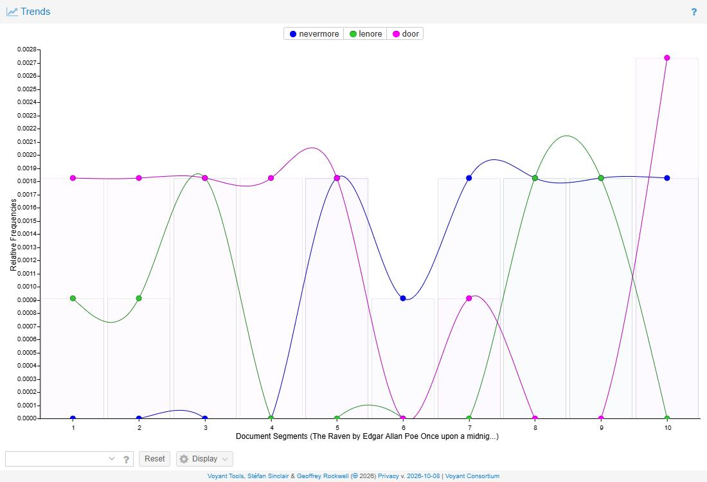

# Make 5 – How Machines Read: "The Raven"

Two machines read the same poem. One counted it. The other explained it. Neither one read it the way I did, and the gap between the three readings is the artifact.

## The Text

**"The Raven" by Edgar Allan Poe (1845).** 18 stanzas, 108 lines, about 1,090 words. Source: [Project Gutenberg eBook #1065](https://www.gutenberg.org/ebooks/1065), plain-text edition, public domain. I stripped the Gutenberg header and license and kept the title and author line; the exact file I fed to both tools is saved at [assets/text/the-raven.txt](../assets/text/the-raven.txt).

I picked it because the poem is built out of repetition. The narrator ends six of the first seven stanzas with "nothing more," and the bird ends the rest with "Nevermore." If a word-counting tool is going to be good at anything, it should be good at this.

## Reading 1: Voyant Tools

I pasted the text into [Voyant Tools](https://voyant-tools.org/) and worked through the Cirrus, Terms, Trends, Collocates and Contexts panels, with the default settings first and then with the settings changed.

![Voyant Tools default five-panel view of The Raven. Top left: a Cirrus word cloud dominated by door, chamber, raven, nevermore, lenore and bird. Top middle: the Reader panel showing the opening lines. Top right: a Trends line chart of the five most frequent terms across ten document segments. Bottom left: the Summary panel, reading "This corpus has 1 document with 1,096 total words and 441 unique word forms," with vocabulary density 0.402 and the most frequent words listed as door (14), raven (11), nevermore (11), chamber (11), bird (10). Bottom right: the Contexts panel listing lines around the word "door."](../assets/images/make5-voyant-overview.png)

### Word frequency

The most frequent word in "The Raven" is not *raven* or *nevermore*. It is *door* (14), followed by *raven*, *nevermore* and *chamber* (11 each), *bird* (10) and *lenore* (8). The poem's furniture outranks its feelings: *bust* appears 6 times, *sorrow* only 3. Voyant also reports a vocabulary density of 0.402, meaning that about four words in ten are new. For a poem that feels like it repeats constantly, that was higher than I expected, and it is a reminder that the repetition is concentrated in a few words rather than spread across the whole text.

One of those eleven *raven*s is mine, not Poe's. Voyant counted the title line I left in. The count looks objective, but it starts with a decision I made about what to paste.

The word cloud is the same information with the numbers taken off. It is good at making the poem feel like a single mood (dark room, bird, door, a name) and bad at telling you anything you could check.

### Trends: where the words land

Trends splits the poem into ten equal chunks of about 110 words and plots how often each word shows up in each chunk. This is the view that showed me things I had not noticed in years of hearing this poem:

- *Door* and *chamber* are everywhere in the first half, then almost disappear. *Chamber* is absent from segments 6 through 9 and comes back exactly once, in the last stanza. Once the bird is in the room, the poem stops talking about the way in.
- *Nevermore* does not exist until segment 5 (stanzas 8 to 10) and then appears in every segment to the end. Eleven times total, every one of them in the second half.
- *Lenore* bookends the poem: segments 1 to 3 and 8 to 9, nothing in between. The narrator says her name, gets distracted by the bird, and then the bird drags her name back out of him.
- *Door* spikes to its highest point at the very end, when the narrator is begging the bird to leave: "quit the bust above my door," "take thy form from off my door."

### The word Voyant would not show me

I wanted to chart the refrain itself: *nothing* (from "nothing more") against *nevermore*. I typed both terms into Trends. Only one came back.

Voyant's default English stopword list treats *nothing* as a function word and deletes it, along with *more*, *still* and *above*. It does this even when you ask for the word by name. The first refrain of the poem, the one the narrator uses to calm himself down six times, is invisible in the default view. So is the collocation "nothing more," because both halves are stopwords. When I turned the stoplist off, the chart I was looking for appeared:

*Nothing* appears 7 times, in stanzas 1, 3, 4, 5, 6 and 7 plus one straggler in stanza 10 ("Nothing farther then he uttered"). *Nevermore* appears 11 times, stanzas 8 through 18. They trade places at a single hinge, segment 5, which is the moment the bird first speaks. The whole structure of the poem is one refrain handing off to another, and I could only see it after overriding the tool. By the Summary panel's own numbers, the stoplist keeps 341 of the poem's 441 unique word forms and only 542 of its 1,096 words. Half the poem was never on the table.

### Collocates and contexts

Collocates lists the words that keep showing up within five words of each other. The strongest pair is *chamber* and *door* (10), then *raven* and *nevermore* (8), *raven* and *quoth* (5), *nevermore* and *quoth* (5), *door* and *bust* (4). Lower down, *lenore* pairs with *maiden* and *angels* (3 each), because Poe repeats the line "rare and radiant maiden whom the angels name Lenore" almost word for word. What Collocates actually detects is Poe's habit of repeating entire phrases. It cannot tell the difference between a phrase repeated for music and a phrase repeated because the narrator is stuck.

Contexts is the closest Voyant gets to reading. It shows all eleven *nevermore*s with the words around them. Reading the left column, I could see that the bird says it ("Quoth the Raven" five times, "Then the bird said," "croaking"), but the last one, "Shall be lifted—nevermore!", is the narrator's own voice. The tool put that fact in front of me. It did not know it was there.

## Reading 2: GPT

I sent the same text file to GPT four times, each in a fresh session so nothing carried over. Following Fran's practice sheet, I asked for an interpretation without naming any themes, repeated that exact prompt to check consistency, then asked about historical context and about symbolism. The complete responses are saved, unedited, at [text-analysis-gpt-transcripts.md](text-analysis-gpt-transcripts.md).

**Prompt 1 (open):** "Here is the full text of a poem. Please give me a literary analysis of it." The prompt did not name the poem or suggest any themes, though the pasted file began with its title and author line. GPT produced about 1,000 words organized under headings: grief, the changing meaning of "Nevermore," the bust of Pallas, sound and rhythm, religious allusions, the ending. Its thesis was that the poem is about "how grief can turn the desire for comfort into a form of self-torment," because the narrator keeps asking a one-word bird questions he knows the answer to. It quoted the text accurately every time I checked, and it noticed two things I had only seen through Voyant: that "nothing more" gives way to "Nevermore," and that the last "nevermore" is spoken by the narrator, not the bird.

**Prompt 2 (the same prompt, again):** The second run opened with almost the same sentence: the poem "explores how grief can turn the desire for reassurance into a cycle of self-torment." Same headings in a slightly different order, same examples (dreary/weary, napping/tapping, the trochaic rhythm, nepenthe, balm in Gilead, Aidenn, the shift to present tense at the end), same bust-of-Pallas-as-reason reading. The run was shorter and dropped the point about who speaks the final word. Two "independent" readings landed in the same place because they are not independent. They are both the average of everything GPT has seen written about this poem.

**Prompt 3 (historical context):** GPT placed the poem in American Romanticism and the Gothic, dated it to 1845, mentioned Virginia Poe's tuberculosis and her death in 1847, and brought up Poe's 1846 essay "The Philosophy of Composition." I checked those dates against the Edgar Allan Poe Society of Baltimore and they are right. The weakness is not error but flatness: it reads like the first page of any study guide, with no specifics about where the poem appeared or how it was received, and nearly every claim is cushioned ("may," "can suggest," "need not be accepted"). It also warned me not to read Lenore as Virginia, which is good advice that it offered unprompted and that it offers, I suspect, to everyone.

**Prompt 4 (symbolism):** Asked whether the raven should be read literally or figuratively, GPT answered "both": a real bird that becomes a symbol through the narrator's grief. That is a defensible reading. It is also the reading that cannot be wrong.

## Comparison: Two Ideas of "Meaning"

| | Voyant | GPT |
|---|---|---|
| What it reads | 1,096 word tokens, one at a time | The whole poem as one object, plus everything it has absorbed about the poem |
| What "meaning" is | A shape: how often a word appears, where it lands, what it sits next to | A paraphrase: what the poem is "about," in the voice of a confident essay |
| What it showed me | The exact hinge between the two refrains; *chamber* vanishing; *door* spiking at the end; *Lenore* as bookends | The narrator supplies the bird's meanings; the bust of Pallas as reason overshadowed; the final word is the narrator's |
| What it hid | Half the words, via the stoplist; tone, speaker, irony; the word *nothing* | Its sources; its process; the difference between this poem and essays about this poem |
| How it fails | Silently. It dropped a word I asked for and said nothing | Confidently. Two fresh runs, one thesis, no counts, no line numbers, hedges everywhere |
| What I had to do | Turn off the stoplist, choose the terms, read the contexts myself | Check the quotes, compare the runs, notice what every answer had in common |

## Reflection

Voyant read "The Raven" the way a scale reads a bag of groceries. It told me the poem weighs 1,096 words, that *door* is the heaviest, and that *nevermore* does not exist until segment 5 and then never leaves. I knew the refrain changes; I did not know it flips at one hinge, or that *chamber* nearly disappears mid-poem. But Voyant also quietly threw away half the poem. Its default stopword list removed *nothing*, *more*, *still* and *above*, so the first refrain was invisible until I turned the list off. The tool decided which words were allowed to mean something before I asked a question.

GPT read the poem the way a well-prepared classmate would. It saw the "nothing more" to "Nevermore" shift immediately, explained the bust of Pallas, and quoted lines accurately. But when I sent the same prompt twice, I got the same thesis in almost the same sentence. That is not a reading. It is a report on what readings usually say. It never counted anything or showed where its confidence came from.

So we gain a count that cannot be argued with and a summary that arrives in seconds. We lose the moment where meaning gets made, because both tools hide it, one in a stoplist and one in training data. Voyant imagines meaning as a shape: how often and where a word lands. GPT imagines meaning as a consensus: what a sentence about this poem is supposed to sound like. Voyant can show me the hinge but not what turns on it. GPT can tell me what turns on it but not where it is, or whether it checked. Putting the two together, and deciding what the stoplist should have kept, was the only actual reading in this make.

## Attribution & AI Use

- **Text used:** "The Raven" by Edgar Allan Poe, first published 1845. Source: [Project Gutenberg eBook #1065](https://www.gutenberg.org/ebooks/1065), plain-text file, public domain. Gutenberg header and license removed; title and author line kept. The exact text given to both tools: [assets/text/the-raven.txt](../assets/text/the-raven.txt).
- **Tools used:** [Voyant Tools](https://voyant-tools.org/) (web version, build 2026-10-08): Summary, Cirrus, Terms, Trends, Collocates and Contexts, with the default English stoplist on and then off. GPT 6.1 Sol (OpenAI), run through Perplexity Computer in four separate fresh sessions on October 11, 2026. Perplexity Computer (Claude) also helped me make this page: it loaded the text into Voyant and took the screenshots, pulled the exact counts and segment distributions from Voyant's data export, sent the four GPT prompts, fact-checked GPT's dates, and turned my observations and decisions into a first draft of this text, which I reviewed before posting.
- **GPT prompts (exact):**
  1. "Here is the full text of a poem. Please give me a literary analysis of it." (the text file pasted below, which begins with the title and author line; no themes suggested)
  2. Same prompt as 1, word for word, in a new session.
  3. "Here is the full text of 'The Raven' by Edgar Allan Poe. What is the historical context of this poem, and how does that context shape how we should read it?"
  4. "Here is the full text of 'The Raven' by Edgar Allan Poe. What does the raven symbolize in this poem? Should the bird be read literally or figuratively?"
  Each GPT run was wrapped in a one-line instruction to answer as a plain chat assistant without using tools or searching the web. Full responses: [text-analysis-gpt-transcripts.md](text-analysis-gpt-transcripts.md).
- **What Voyant could not do:** It could not tell me that *nothing* mattered; it deleted the word by default, along with *more*, *still* and *above*, and with them the poem's first refrain and the collocation "nothing more." It could not tell who speaks a word, or that the narrator's "nothing more" is self-reassurance rather than description. It could not distinguish a phrase repeated for sound from one repeated out of obsession. It produced no interpretation at all; everything in the Voyant section above that is not a number is me.
- **What GPT could not do:** It could not show its work. It gave no counts, no stanza or line numbers, and no indication of which claims came from this text and which came from the thousands of essays about it. Two fresh runs of the same prompt produced the same thesis, so it could not give me a second opinion. It hedged nearly every interpretive claim, and on the literal-versus-figurative question it chose "both." It could not tell me what it did not know.
- **Full log:** [pages/ai-log/2026-10-11-make5-text-analysis.md](../pages/ai-log/2026-10-11-make5-text-analysis.md)
