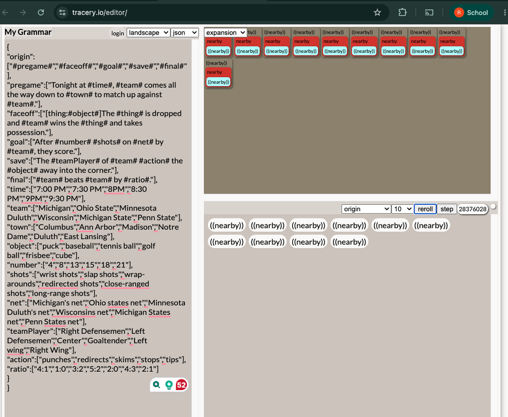

# Make 8 – What Is This Tom Foolery? A Hockey Broadcast Call Generator

Hockey broadcast calls, generated by rules I wrote, then judged by me. Five sentence shapes, ten word lists, 100 outputs, 80 of them read line by line, ten kept.

## The Generator

It is a [Tracery](https://tracery.io) grammar. Tracery is not AI: it is a randomizer that fills the blanks in my sentence shapes from my word lists, and it does not know what the sentences mean. The grammar has five shapes (the pre-game call, the faceoff, the goal, the save and the final score) and ten lists for the parts that change: time, team, town, object, number, shots, net, player, action and ratio.

To run it: open the [Tracery editor](https://tracery.io/editor/), click in the "My Grammar" box, select everything and paste the grammar below (also saved as [broadcast-grammar.json](../assets/data/broadcast-grammar.json)). Set the dropdown to `origin`, the count to `10`, and hit reroll.

```json
{
"origin":["#pregame#","#faceoff#","#goal#","#save#","#final#"],
"pregame":["Tonight at #time#, #team# comes all the way down to #town# to match up against #team#."],
"faceoff":["[thing:#object#]The #thing# is dropped and #team# wins the #thing# and takes possession."],
"goal":["After #number# #shots# on #net# by #team#, they score."],
"save":["The #teamPlayer# of #team# #action# the #object# away into the corner."],
"final":["#team# beats #team# by #ratio#."],
"time":["7:00 PM","7:30 PM","8PM","8:30 PM","9PM","9:30 PM"],
"team":["Michigan","Ohio State","Minnesota Duluth","Wisconsin","Michigan State","Penn State"],
"town":["Columbus","Ann Arbor","Madison","Notre Dame","Duluth","East Lansing"],
"object":["puck","baseball","tennis ball","golf ball","frisby","cube"],
"number":["4","8","13","15","18","21"],
"shots":["wrist shots","slap shots","wrap-arounds","redirected shots","close-ranged shots","long-range shots"],
"net":["Michigan's net","Ohio states net","Minnesota Duluth's net","Wisconsins net","Michigan States net","Penn States net"],
"teamPlayer":["Right Defensemen","Left Defensemen","Center","Goaltender","Left wing","Right Wing"],
"action":["punches","redirects","skims","stops","tips"],
"ratio":["4:1","1:0","3:2","5:2","2:0","4:3","2:1"]
}
```




## Curated Outputs

I generated 100 lines in ten batches of ten (batch screenshots: [1](../assets/images/make8-batch-01.png) · [2](../assets/images/make8-batch-02.png) · [3](../assets/images/make8-batch-03.png) · [4](../assets/images/make8-batch-04.png) · [5](../assets/images/make8-batch-05.png) · [6](../assets/images/make8-batch-06.png) · [7](../assets/images/make8-batch-07.png) · [8](../assets/images/make8-batch-08.png) · [9](../assets/images/make8-batch-09.png) · [10](../assets/images/make8-batch-10.png)) and read 80 of them with three questions:

1. **Q1 — Does the sentence agree with itself?** The program is a randomizer working from my lists; it does not know what it is saying, so it can produce "Minnesota Duluth beats Minnesota Duluth." If two slots in one output contradict each other, it is out.
2. **Q2 — Could it be said on a real broadcast?** The system does not work like an actual AI, so it cannot sort out the realistic outcomes on its own. I do that part: if a hockey fan would notice something off, it does not pass as realistic.
3. **Q3 — Does the failure show me which rule broke?** A line that fails Q1 or Q2 is still worth keeping if it calls out what broke down.

### The ten I kept

Ranked by how hard I reacted when I read them.

- **#7** "The puck is dropped and Minnesota Duluth wins the puck and takes possession." — passes Q1 and Q2. My note when I read it: *Best one yet*
- **#12** "After 15 close-ranged shots on Penn States net by Wisconsin, they score." — passes Q1 and Q2. My note when I read it: *best one ive read so far*
- **#14** "The puck is dropped and Michigan wins the puck and takes possession." — passes Q1 and Q2. My note when I read it: *Perfect*
- **#17** "The puck is dropped and Wisconsin wins the puck and takes possession." — passes Q1 and Q2. My note when I read it: *Yes! perect*
- **#58** "Tonight at 9PM, Michigan comes all the way down to Duluth to match up against Minnesota Duluth." — passes Q1 and Q2. My note when I read it: *Finally a perfect one!!!*
- **#80** "The Goaltender of Michigan skims the cube away into the corner." — passes Q1; the cube is the only thing wrong, and the goaltender makes it work. My note when I read it: *Perfection!*
- **#68** "After 15 redirected shots on Michigan's net by Michigan State, they score." — passes Q1 and Q2. My note when I read it: *good rivalry match up and good line!*
- **#69** "Michigan beats Michigan State by 3:2." — passes Q1 and Q2. My note when I read it: *BAM!*
- **#75** "Michigan State beats Ohio State by 4:1." — passes Q1 and Q2. My note when I read it: *Lets go!!!*
- **#29** "The Left wing of Michigan redirects the puck away into the corner." — passes Q1 and Q2. My note when I read it: *honestly realistic*

### The duds

- **#4** "Penn State beats Penn State by 2:1." — fails Q1. My note when I read it: *basically suicide*
- **#5** "Tonight at 9:30 PM, Wisconsin comes all the way down to East Lansing to match up against Minnesota Duluth." — fails Q2. My note when I read it: *East lansing is not even in minnesota*
- **#6** "Tonight at 8PM, Wisconsin comes all the way down to Madison to match up against Penn State." — fails Q2. My note when I read it: *Penn state plays at Madison?*
- **#19** "The Center of Wisconsin stops the frisby away into the corner." — fails Q2. My note when I read it: *whos playing frisbee on ice?*
- **#24** "Tonight at 7:30 PM, Ohio State comes all the way down to Duluth to match up against Ohio State." — fails Q1. My note when I read it: *both teams play eachother not at their rink?*
- **#48** "Tonight at 7:30 PM, Wisconsin comes all the way down to Madison to match up against Michigan." — fails Q2. My note when I read it: *Madison is literally in Wisconsin*
- **#62** "Tonight at 8:30 PM, Ohio State comes all the way down to Columbus to match up against Minnesota Duluth." — fails Q2. My note when I read it: *ohio state university is in columbus…*
- **#63** "Michigan beats Michigan by 3:2." — fails Q1. My note when I read it: *what is this Tom Foolery?*
- **#64** "After 21 close-ranged shots on Michigan States net by Minnesota Duluth, they score." — fails Q2. My note when I read it: *How do you miss 21 shots near the crease of the net?*
- **#65** "After 21 wrap-arounds on Minnesota Duluth's net by Minnesota Duluth, they score." — fails Q1. My note when I read it: *So own-goaling?*
- **#71** "Tonight at 8PM, Penn State comes all the way down to Notre Dame to match up against Penn State." — fails Q1. My note when I read it: *or just say Penn State plays Notre Dame and not be a total idiot*

<details markdown="1">
<summary><strong>All 100 outputs with my notes</strong> (80 annotated; the last two batches were generated but not read)</summary>

1. The tennis ball is dropped and Wisconsin wins the tennis ball and takes possession. — literally no tennis ball at all mentioned in hockey before
2. Ohio State beats Michigan by 1:0. — Thank God
3. The Center of Michigan State redirects the cube away into the corner. — a cube?
4. Penn State beats Penn State by 2:1. — basically suicide
5. Tonight at 9:30 PM, Wisconsin comes all the way down to East Lansing to match up against Minnesota Duluth. — East lansing is not even in minnesota
6. Tonight at 8PM, Wisconsin comes all the way down to Madison to match up against Penn State. — Penn state plays at Madison?
7. The puck is dropped and Minnesota Duluth wins the puck and takes possession. — Best one yet
8. Ohio State beats Minnesota Duluth by 4:3. — Fair
9. Michigan beats Penn State by 3:2. — Lets go!
10. Ohio State beats Minnesota Duluth by 2:0. — Fair
11. The tennis ball is dropped and Ohio State wins the tennis ball and takes possession. — whatever
12. After 15 close-ranged shots on Penn States net by Wisconsin, they score. — best one ive read so far
13. After 15 wrap-arounds on Michigan's net by Ohio State, they score. — 15 is a little to unrealistic
14. The puck is dropped and Michigan wins the puck and takes possession. — Perfect
15. After 21 wrist shots on Wisconsins net by Michigan State, they score. — good
16. The cube is dropped and Penn State wins the cube and takes possession. — i mean the cube is the only thing wrong here
17. The puck is dropped and Wisconsin wins the puck and takes possession. — Yes! perect
18. The golf ball is dropped and Michigan wins the golf ball and takes possession. — Golf ball?
19. The Center of Wisconsin stops the frisby away into the corner. — whos playing frisbee on ice?
20. Wisconsin beats Minnesota Duluth by 2:0. — ok fair
21. The tennis ball is dropped and Michigan State wins the tennis ball and takes possession. — why are tennis balls even at a hockey game?
22. Wisconsin beats Michigan State by 4:3. — Fair
23. Tonight at 7:00 PM, Minnesota Duluth comes all the way down to Columbus to match up against Penn State. — Columbus isnt even in Pennsylvania
24. Tonight at 7:30 PM, Ohio State comes all the way down to Duluth to match up against Ohio State. — both teams play eachother not at their rink?
25. The golf ball is dropped and Michigan wins the golf ball and takes possession. — golf balls arent in hockey
26. Minnesota Duluth beats Penn State by 3:2. — fair
27. Tonight at 8PM, Michigan comes all the way down to Notre Dame to match up against Ohio State. — the same inaccurate realistic scenario as in line 23
28. Wisconsin beats Ohio State by 4:3. — fair
29. The Left wing of Michigan redirects the puck away into the corner. — honestly realistic
30. The cube is dropped and Minnesota Duluth wins the cube and takes possession. — i mean a rubber cube coudlve been acceptable
31. The frisby is dropped and Minnesota Duluth wins the frisby and takes possession. — whatever
32. The Left wing of Ohio State tips the baseball away into the corner. — oh jesus
33. The Right Wing of Minnesota Duluth redirects the baseball away into the corner. — not again…
34. The frisby is dropped and Minnesota Duluth wins the frisby and takes possession. — Are you serious?
35. Penn State beats Minnesota Duluth by 5:2. — finally a good one here
36. The Left Defensemen of Ohio State skims the puck away into the corner. — ok better
37. Ohio State beats Ohio State by 3:2. — again. suicide.
38. The cube is dropped and Ohio State wins the cube and takes possession. — no more cubes mentioned please
39. The Right Defensemen of Ohio State tips the puck away into the corner. — good line
40. Tonight at 7:30 PM, Michigan State comes all the way down to Duluth to match up against Ohio State. — Ohio state isnt in Minnesota…
41. Wisconsin beats Minnesota Duluth by 1:0. — Good
42. Michigan State beats Wisconsin by 5:2. — Lets go!
43. After 4 long-range shots on Wisconsins net by Wisconsin, they score. — Really good so far!
44. After 4 wrap-arounds on Michigan's net by Michigan, they score. — Keep it coming!
45. After 13 redirected shots on Michigan States net by Penn State, they score. — good
46. The frisby is dropped and Michigan State wins the frisby and takes possession. — Unless its a throwaway game
47. Wisconsin beats Michigan State by 5:2. — Fair
48. Tonight at 7:30 PM, Wisconsin comes all the way down to Madison to match up against Michigan. — Madison is literally in Wisconsin
49. Wisconsin beats Michigan by 3:2. — Ok good
50. The Right Wing of Michigan redirects the golf ball away into the corner. — Shanked!
51. The frisby is dropped and Michigan wins the frisby and takes possession. — dear god
52. Tonight at 7:30 PM, Penn State comes all the way down to Ann Arbor to match up against Minnesota Duluth. — Ann arbor is in Michigan but ok
53. The Center of Minnesota Duluth redirects the frisby away into the corner. — bro what?
54. The frisby is dropped and Michigan wins the frisby and takes possession. — dude not gain
55. The Center of Penn State stops the cube away into the corner. — i mean i guess?
56. The Right Defensemen of Ohio State skims the puck away into the corner. — Ok pretty good!
57. The baseball is dropped and Penn State wins the baseball and takes possession. — im not a big baseball guy so what the hell?
58. Tonight at 9PM, Michigan comes all the way down to Duluth to match up against Minnesota Duluth. — Finally a perfect one!!!
59. After 8 slap shots on Michigan's net by Minnesota Duluth, they score. — Ok good.
60. Tonight at 9:30 PM, Ohio State comes all the way down to Duluth to match up against Michigan State. — ended on a bad note
61. Minnesota Duluth beats Michigan by 4:3. — ok
62. Tonight at 8:30 PM, Ohio State comes all the way down to Columbus to match up against Minnesota Duluth. — ohio state university is in columbus…
63. Michigan beats Michigan by 3:2. — what is this Tom Foolery?
64. After 21 close-ranged shots on Michigan States net by Minnesota Duluth, they score. — How do you miss 21 shots near the crease of the net?
65. After 21 wrap-arounds on Minnesota Duluth's net by Minnesota Duluth, they score. — So own-goaling?
66. Ohio State beats Ohio State by 4:3. — suicide again
67. The frisby is dropped and Ohio State wins the frisby and takes possession. — You gotta be kidding me
68. After 15 redirected shots on Michigan's net by Michigan State, they score. — good rivalry match up and good line!
69. Michigan beats Michigan State by 3:2. — BAM!
70. The Right Wing of Penn State skims the cube away into the corner. — oh no…
71. Tonight at 8PM, Penn State comes all the way down to Notre Dame to match up against Penn State. — or just say Penn State plays Notre Dame and not be a total idiot
72. After 13 close-ranged shots on Ohio states net by Penn State, they score. — good!
73. The baseball is dropped and Michigan wins the baseball and takes possession. — since when is michigan good at baseball?
74. The tennis ball is dropped and Michigan State wins the tennis ball and takes possession. — oh my god plays dont continue this.
75. Michigan State beats Ohio State by 4:1. — Lets go!!!
76. Michigan State beats Penn State by 2:1. — Alright!
77. After 13 redirected shots on Wisconsins net by Michigan State, they score. — solid line
78. The Left Defensemen of Penn State tips the cube away into the corner. — ehhh
79. After 15 redirected shots on Ohio states net by Michigan State, they score. — ok fair
80. The Goaltender of Michigan skims the cube away into the corner. — Perfection!
81. The puck is dropped and Wisconsin wins the puck and takes possession. — *(not read — I stopped annotating at 80)*
82. Tonight at 9PM, Minnesota Duluth comes all the way down to Notre Dame to match up against Ohio State. — *(not read — I stopped annotating at 80)*
83. After 18 wrap-arounds on Michigan's net by Michigan State, they score. — *(not read — I stopped annotating at 80)*
84. Ohio State beats Michigan by 4:3. — *(not read — I stopped annotating at 80)*
85. After 13 wrist shots on Michigan States net by Penn State, they score. — *(not read — I stopped annotating at 80)*
86. The Right Wing of Wisconsin stops the cube away into the corner. — *(not read — I stopped annotating at 80)*
87. The Left Defensemen of Michigan State skims the puck away into the corner. — *(not read — I stopped annotating at 80)*
88. The Left Defensemen of Penn State stops the baseball away into the corner. — *(not read — I stopped annotating at 80)*
89. The tennis ball is dropped and Michigan State wins the tennis ball and takes possession. — *(not read — I stopped annotating at 80)*
90. Wisconsin beats Wisconsin by 5:2. — *(not read — I stopped annotating at 80)*
91. Minnesota Duluth beats Wisconsin by 2:1. — *(not read — I stopped annotating at 80)*
92. After 8 wrist shots on Michigan States net by Ohio State, they score. — *(not read — I stopped annotating at 80)*
93. The puck is dropped and Wisconsin wins the puck and takes possession. — *(not read — I stopped annotating at 80)*
94. Michigan beats Michigan State by 1:0. — *(not read — I stopped annotating at 80)*
95. The puck is dropped and Wisconsin wins the puck and takes possession. — *(not read — I stopped annotating at 80)*
96. Tonight at 7:00 PM, Ohio State comes all the way down to East Lansing to match up against Minnesota Duluth. — *(not read — I stopped annotating at 80)*
97. Tonight at 8PM, Ohio State comes all the way down to Columbus to match up against Penn State. — *(not read — I stopped annotating at 80)*
98. The Left Defensemen of Penn State punches the cube away into the corner. — *(not read — I stopped annotating at 80)*
99. The puck is dropped and Wisconsin wins the puck and takes possession. — *(not read — I stopped annotating at 80)*
100. After 18 long-range shots on Ohio states net by Minnesota Duluth, they score. — *(not read — I stopped annotating at 80)*

</details>

## Process Documentation

I built this make in the Tracery editor at tracery.io. I started by editing out the original text in the website and replacing the words with my own hockey-related ones, and it took a while. Before I touched the editor I wrote everything in a Google Doc in plain words: the subject (hockey broadcast calls), five sentence shapes (the pre-game call, the faceoff, the goal, the save and the final score) and ten lists for the parts that change: time, team, town, object, number, shots, net, player, action and ratio. The teams are Big Ten hockey schools plus Minnesota Duluth, the towns are their cities, and the object list is where I put the jokes: puck, baseball, tennis ball, golf ball, frisby, cube. Perplexity converted my lists into Tracery's JSON format because I kept breaking the syntax; the words are all mine. When I pasted it in, an extra closing brace broke the whole grammar, and once that was fixed the outputs appeared.

What I controlled: every word in every list, which five shapes existed, letting the same team list fill both team slots (which is why teams sometimes play themselves) and the decision to make the faceoff line use the same object twice. I set the editor to 10 outputs per reroll and rerolled ten times, so I generated 100 lines: 91 unique, 5 repeats, and 10 where a team plays itself. I read and annotated 80 of them line by line. 100 felt like a lot, so I stopped around 80.

My first instinct was to judge whole batches, keep or reject a screen of ten at a time, before I realized the unit had to be the sentence. Then I used the three questions above. I marked about 36 lines positively, and the ten on this page are the ones I gave the strongest reactions to.

## Artist Statement

None of the 100 outputs sounded like a real broadcast, and some of them were statements like "Minnesota Duluth beats Minnesota Duluth by 3:2." That makes sense, because the website is a coded randomizer based on my input. It does not function like an actual AI; it could not sort out the best and most realistic outcomes on its own. So the sorting was me. The creative part was deciding the idea, the teams and the scenario, announcer calls in a hockey game, and then choosing: "basically suicide" for a team beating itself, "Madison is literally in Wisconsin" when the away team travelled to its own rink, and "how do you miss 21 shots near the crease of the net?" That last one is a goalie's reaction, not a fan's. If someone read my picks, they would know it was not AI-orchestrated, because the enthusiasm of how I reacted to each line is in the reasons. I also missed two: at #43 and #44 I wrote "Really good so far!" on lines where a team scores on its own net, the same mistake I caught at #65. The randomizer never gets tired; I did.

Whether a failed output is worth keeping depends on the algorithm you are trying to build. With a template like this one, when it fails you can still call out what broke down, right and wrong, with unlimited attempts, because the rules are mine and I can see them. If I tried to build a preferred Instagram feed by liking and interacting with specific content and it failed anyway, that is a different story: the rules are hidden and I cannot fix them.

In this make there was basically no AI creativity at all; Tracery is a randomizer, not an AI. Pure human creativity would have been writing the calls myself. This one sits in between: I wrote the rules and the reactions, and the machine did the combining. I knew to stop at 80, when 100 felt like a lot and the lines had started repeating.

## Attribution & AI Use

- **Tools used:** the [Tracery editor](https://tracery.io/editor/) by Kate Compton (not an AI tool: a grammar-based randomizer); Google Docs for the plain-text lists and the line-by-line notes; Perplexity Computer (Claude) as a tutor and formatter.
- **AI prompts (summary):** I asked Perplexity to walk me through the brief and help me choose a track; to explain how the Tracery editor works and what was breaking when I edited the sample grammar; to convert my plain-text shapes and lists into Tracery's JSON; to type out my ten batch screenshots as text and count shapes, repeats and self-matches; to rephrase my criteria paragraph into three yes/no questions; and to clean up the grammar and order of my process documentation and artist statement. At one point I asked it to do the curation and the writing for me, and it declined.
- **What AI generated:** none of the outputs (Tracery is not AI), none of the words in the lists, none of the picks or the notes on them. It produced the JSON formatting, the transcription and counts, the question form of my criteria, the edits to my two statements, this page's layout and the first draft of the AI log, and it made the commit to this repository.
- **What I changed or decided:** the subject, the five shapes, every list, the match decision on the faceoff line, reading 80 of 100, the three questions, every keep and every dud and the reason for each, and the title. I reviewed the edited statements and the log before they went live.

Full log: [AI Use Log – Make 8](../pages/ai-log/2026-11-01-make8-generator.md). Working document with the plain-text lists, batch screenshots and all 80 line notes: Google Doc, available on request.
