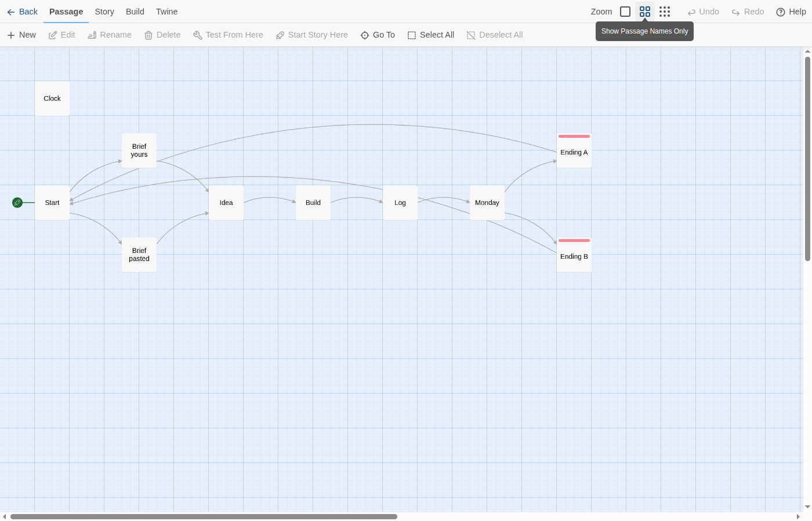

# Make 9 – Make 6: A Game About the Night I Handed a Make to an Agent

A short Twine game about the night I handed Make 6 to an AI agent with three words, told so that you get to make the four decisions I skipped and find out what each one costs. Nine passages, four choices, two endings, one clock you can see and one counter you can't.

## The Game

**[Play Make 6](make6-game.html)** (opens full screen, 5–7 minutes; play it twice, once handing everything off and once keeping it). The HTML file is also the one submitted on Canvas: [download make6-game.html](make6-game.html).

<iframe src="make6-game.html" title="Make 6: an interactive story about handing a make to an AI agent" width="100%" height="620" loading="lazy" style="border:1px solid #d0d7de;border-radius:6px;background:#0e0f12;"></iframe>

It is a Twine 2 story in the Harlowe 3 format. The source is in [make6.twee](../assets/data/make6.twee) (every passage, every rule, readable as plain text), and it imports straight into the [Twine editor](https://twinery.org/2/) if you want to see the map or test from any passage.

![The opening passage. A small monospace clock at the top reads 6:30 PM. The text: You are in the library. You have multiple things due by midnight. You are overwhelmed. You have practice tonight as well. DH Make 6 is due by midnight, and it's the last thing on the list. You grab an energy drink and eat some food. The agent window is already open and ready. You start screenshotting every piece of description from the assignment on Canvas. You import them in the agent window. Two yellow links: Ask it to explain the make so you can build it yourself, and Type "Complete Make 6."](../assets/images/make9-start.png)

![The Build passage after taking the agent's first concept. Clock reads 6:50 PM. The consequence line: "The Cloud has a body," made by the agent, made you lose your work ethic. Your work ethic is supposed to be doing everything by hand and being transparent with yourself. Then: While the agent builds, you grab a granola bar from your backpack and start the other assignment that's due tonight. After four minutes, you come back to what the agent has to offer: a finished page and the map of data centers. Two links: Read the whole thing before it goes up, and Type "push it as-is."](../assets/images/make9-build.png)

![Ending A, headed MONDAY. You keep it. On Monday, Fran will thank you for your honesty, in a paragraph you didn't write. Monday morning, you're at practice and in the locker room; the grade comes in: 10 out of 10. Then the comment. 'Outstanding,' he says. The log is transparent. And then: 'It's hard to see your own thinking in this.' He wants to talk. You feel guilty. You feel the 100% turned into something else rather than a grade itself. Below a rule: Submitted Sunday at 7:10 PM. Decisions that were yours: 0 of 4.](../assets/images/make9-ending-a.png)

## Design Statement

Make 6 is a Twine game about the night I handed Make 6 to an AI agent with three words, told as a game where you get to make the four decisions I skipped and find out what each one costs. You start at 6:30 PM in the library with practice coming and the make due at midnight. Nine passages, four choices, two endings. Each choice is the same choice in a different form: ask the agent to explain the make or type "Complete Make 6"; take its first concept or write your own; read the 800 words before they go live or type "push it as-is"; keep the AI-use log it wrote in your voice or rewrite it yourself. The log matters most, because it's the one place where even the honesty was automated. Keeping it means the only true sentence on the page is one you didn't write. Two rules carry the argument. The clock at the top of every screen is visible: doing a step yourself costs 75 minutes and handing it off costs 10, so the game makes you feel why I took the shortcut instead of just telling you it was wrong. Hand everything off and you're done at 7:10; keep everything and you hit submit at 11:30. The counter is hidden until the end. The ending isn't decided by what you say or how good the page looks, only by how many decisions were yours, which is exactly what Fran turned out to be grading. Three of four gets you Monday morning with a rougher page and a comment you can hear yourself in. Fewer gets you the comment I actually got: "outstanding," and "hard to see your own thinking." The game shows your score at the end because that's the rule I couldn't see when I was playing it for real.

## Artist Statement

My game argues through its rules that the shortcut is real. Doing a step yourself costs 75 minutes on the clock and handing it off costs 10, so the player feels the pull I felt at 6:30 with practice coming, instead of being told it was wrong. The second rule is hidden: the ending is decided only by how many of the four decisions were yours, not by how good the page looks. That's what Fran was actually grading on Make 6, and I didn't know it until Monday. As a static story, this would be a confession: I handed a make to an agent and got called on it. As a game, it's a choice you make four times, and "push it as-is" is the exact thing I typed. The hardest part was writing about myself in second person. "You type Complete Make 6" is harder to type than "I did," because the player is about to make the choice I made. The AI collaboration worked like this: the assistant proposed the structure, wired the clock and the counter, built the Twine file, and gave me fill-in-the-blank examples when I was stuck. I supplied the facts, chose every option, inserted Fran's real comment, and decided the ending. About half the sentences started as its draft, and I kept the ones that were true. If I did it again, I'd start Monday, like the brief's timeline says, so more of the sentences are mine, and I'd playtest it with a teammate before it went live.

## Process Notes

**How I made it.** Sunday, November 8, 6:30 PM to about 10:30 PM, with the make due at midnight; the game's opening clock is the real one. I picked the concept from three the assistant offered (the other two were a goalie-versus-analytics game and my own idea), and we agreed on the arrangement before anything was written: I write what the player reads and make every decision about the story; the assistant builds the machine around it. The text lives in a Google Doc with one heading per passage and a one-line note on what each passage needed to do. I wrote the passages in second person, present tense, in that Doc, one at a time, and the assistant read the Doc and wired each passage into the game as it was finished, so I could play the growing game while I wrote. The story is my real Make 6: the three messages I actually sent ("Complete Make #6," "push it as-is," and the one about the log), the real "Cloud Has a Body" map, and Fran's real comment, which I pasted into the chat from Canvas and which Ending A echoes in two phrases.

**The rules.** Two of them. The clock at the top of every passage is visible: each hand-off choice adds 10 minutes and each do-it-yourself choice adds 75, so the four paths finish anywhere from 7:10 PM to 11:30 PM. The counter is hidden: every decision that stays yours adds one, and at the end the game routes you to Ending B if three or more of the four were yours, otherwise Ending A, then reveals the score ("Decisions that were yours: 2 of 4"). The choices converge rather than branch (both brief choices lead to the same idea screen, and so on), with a consequence line that changes depending on what you chose, because the point is that it is the same night either way and only the decisions differ.

**What is mine and what started as the assistant's.** Passages 1, 2a, 2b, the body of 3 and 4, the data-center map in the "write your own" branch, the "lose your work ethic" consequence, the last line of Ending A ("the 100% turned into something else rather than a grade itself"), the cost line in Ending B, and the AI policy on the [How I Use AI](../pages/how-i-use-ai.md) page are my sentences, written in the Doc with the assistant's feedback. The consequence lines for passages 4 and 5, the body of passage 5, the frame of both endings, Fran's imagined comment in Ending B, and the choice labels started as options or fill-in-the-blank examples the assistant wrote when I asked for help; I picked between them, filled in the blanks (the locker room, the granola bar, the guilt), and in a few places edited them. The design statement and artist statement were built from my bullet answers and the examples I chose; the assistant expanded them to length and I read and approved them. The full list is in the AI-use log below.

**Tools.** Google Docs (text and version history), Twine 2 / Harlowe 3 (the story format; the compiled file imports into the Twine editor), Tweego 2.1.1 (the compiler the assistant used to turn the Doc text into the HTML file), and Perplexity Computer (Claude) for everything described above.

## Attribution & AI Use

- **Tools used:** Google Docs; Twine 2 (Harlowe 3.1 story format) via Tweego 2.1.1; Perplexity Computer (Claude), one Sunday-evening session. No AI-generated images; the screenshots are of the game and the Twine editor.
- **AI prompts (summary):** "Complete Make 9" with ten screenshots of the Canvas brief; then, passage by passage, "help me write passage 2a in my own words," "give me an example," "help me write the two consequence lines," "use comment A in Ending B," "help me answer the three artist statement questions," "put into one paragraph." I also asked what we had actually done on Make 6 so I could write from the record.
- **What AI generated:** the concept menu and the passage skeleton; all Harlowe code (the clock, the hidden counter, the ending logic, the stylesheet) and the compiled HTML; the choice labels; question lists and fill-in-the-blank templates for each passage; option pairs for the passage 4 and 5 consequence lines, the passage 5 body, the ending frames, and Fran's comment in Ending B; the expansion of my statement bullets to 300 and 250 words; this page's process notes and attribution; the log; the screenshots and the commit.
- **What I changed or decided:** the concept (Make 6, not the goalie game); every fact in the story; the sentences listed above as mine; which option to take at every fork where the assistant offered two; the subject of the "write your own" branch (data centers around Columbus and New Albany); the real comment from Fran in Ending A and the choice to quote only part of it; the design-statement claim that the log is the choice that matters most; the AI policy on the How I Use AI page, in my words; and the decision to push.
- **Full log:** [2026-11-08 – Make 9 (Make 6, the game)](../pages/ai-log/2026-11-08-make9-game.md)
